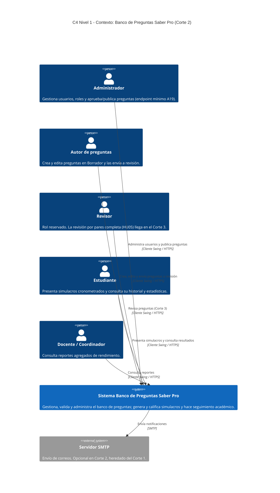
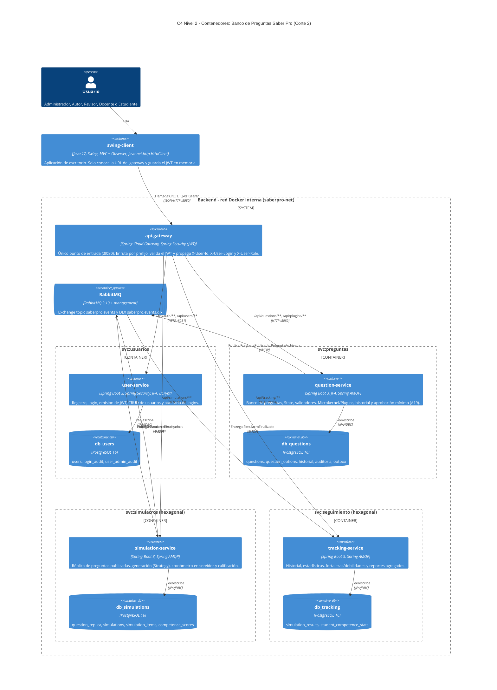
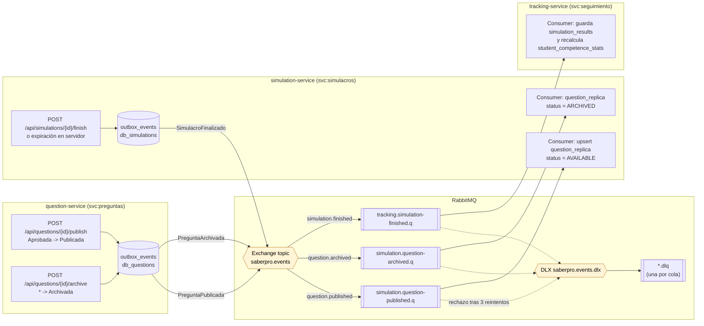

# A02 — Diagramas C4 (niveles 1 y 2) y flujo de eventos

> **Corte 2 · Sprint A · Diseño Ronda 1** · Responsable: Integrante 3 · Talla S
> Fuente editable: carpeta [`diagramas/`](diagramas/). Imágenes generadas con `mmdc` en [`render/`](render/). GitHub renderiza los bloques `mermaid` de este archivo directamente.

## 1. C4 Nivel 1 — Contexto

Archivo: [`diagramas/c4/c4-nivel1-contexto.mmd`](diagramas/c4/c4-nivel1-contexto.mmd)

**Lectura:** cinco actores usan un único sistema a través del cliente Swing. El **Revisor** aparece porque el rol ya existe (RF-03), pero su flujo completo (HU05) es del Corte 3. El SMTP heredado del Corte 1 queda como sistema externo opcional.

## 2. C4 Nivel 2 — Contenedores

Archivo: [`diagramas/c4/c4-nivel2-contenedores.mmd`](diagramas/c4/c4-nivel2-contenedores.mmd)

**Decisiones que muestra el diagrama:**

- El cliente Swing **solo** conoce el gateway (`:8080`); los servicios y las BD no publican puertos al host (salvo en el perfil `dev` de Docker Compose, para depurar).
- Cada servicio está encerrado con **su** base PostgreSQL: no hay flechas entre un servicio y la BD de otro.
- La comunicación entre servicios es **solo asíncrona** (RabbitMQ). No hay llamadas REST servicio-a-servicio en el Corte 2: el `simulation-service` mantiene una réplica local de preguntas en vez de consultar al `question-service` en cada simulacro.

> *Nota:* el motor C4 de Mermaid tiene diseño automático limitado y algunas etiquetas se cruzan. Para la versión del PDF (B19) se puede exportar el PNG de `render/` o redibujar en PlantUML C4 si se necesita control fino de la posición.

## 3. Diagrama de flujo de eventos

Archivo: [`diagramas/eventos/flujo-eventos.mmd`](diagramas/eventos/flujo-eventos.mmd)

**Flujo crítico** (se verificará end-to-end en B17):

1. Un administrador publica una pregunta aprobada → `question-service` guarda el cambio de estado y la fila del outbox en la misma transacción.
2. El *relay* del outbox publica `PreguntaPublicada` en `saberpro.events` con routing key `question.published`.
3. `simulation-service` la consume y hace *upsert* en `question_replica` (idempotente por `eventId` y `source_version`).
4. Un estudiante genera, responde y finaliza un simulacro (o expira) → `SimulacroFinalizado` sale por el outbox del `simulation-service`.
5. `tracking-service` lo consume, guarda el resultado y recalcula `student_competence_stats`.
6. Tras 3 reintentos fallidos, el mensaje va a la DLQ de su cola para inspección manual en la UI de RabbitMQ (`:15672`).

> **B04 (Sprint B):** este diagrama ya incluye `SimulacroFinalizado`. En la Ronda 2 solo habrá que actualizarlo si cambian nombres o se agregan consumidores.
