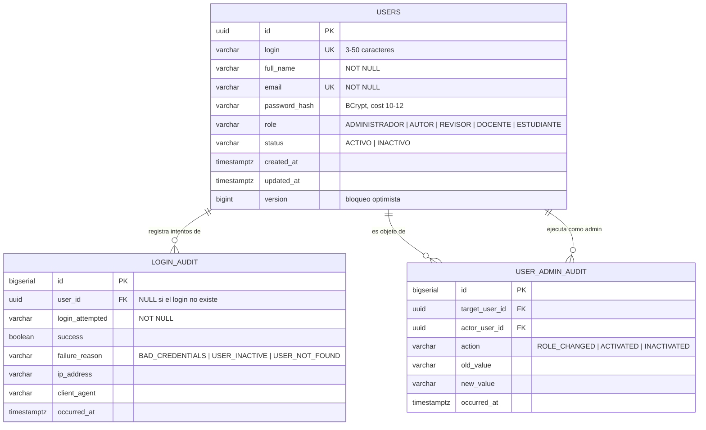
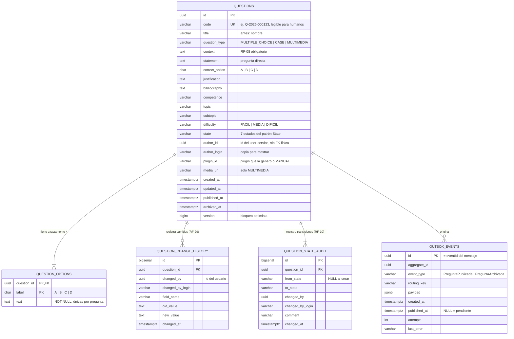
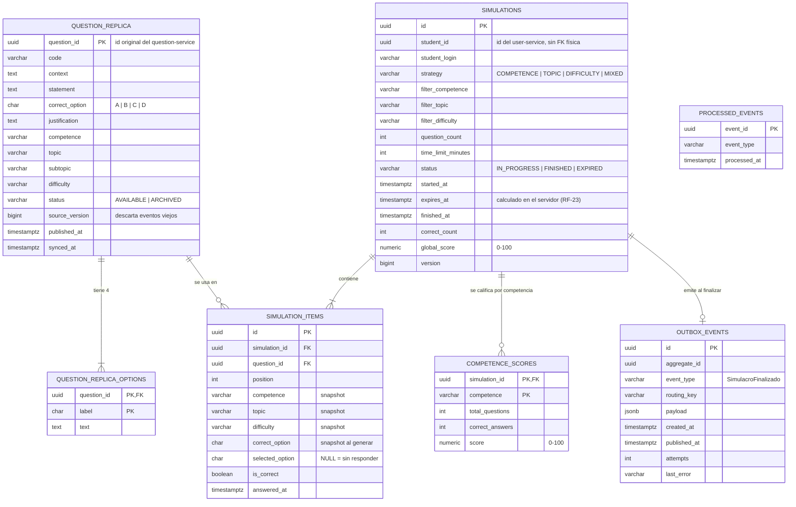
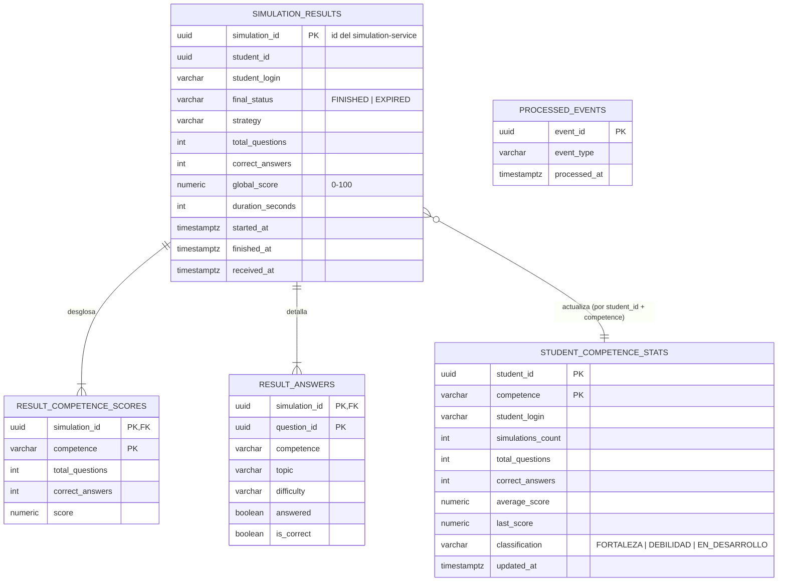

# A03 — Modelo Entidad-Relación por base de datos

> **Corte 2 · Sprint A · Diseño Ronda 1** · Responsable: Integrante 3 · Talla M
> Una base PostgreSQL 16 **independiente** por servicio (una instancia/contenedor por BD en Docker Compose). Fuentes: [`diagramas/er/`](diagramas/er/). Las migraciones se implementan con **Flyway** (`src/main/resources/db/migration/V1__init.sql` en cada servicio) y `spring.jpa.hibernate.ddl-auto=validate`.

## Convenciones comunes

| Convención | Regla |
|---|---|
| Claves primarias | `UUID` generados en la aplicación (`UUID.randomUUID()`), salvo tablas de auditoría/log (`BIGSERIAL`) |
| Fechas | `TIMESTAMPTZ` en UTC |
| Enumeraciones | `VARCHAR` + `CHECK` (no tipos `ENUM` nativos, para que Flyway y JPA `@Enumerated(STRING)` sean simples) |
| Referencias entre servicios | Columnas `*_id` de tipo UUID **sin FK física** (otra BD). Se copia lo necesario para mostrar (`*_login`) — duplicación deliberada |
| Concurrencia | Columna `version` + `@Version` (bloqueo optimista) en agregados editables |
| Borrado | Sin `DELETE` de negocio: estados `ARCHIVADA`, `INACTIVO`, `ARCHIVED` (RNF-16) |
| Idempotencia de eventos | Tabla `processed_events` en cada consumidor |
| Publicación confiable | Tabla `outbox_events` en cada productor |

## 1. `db_users` — user-service

| Tabla | Propósito | Requisito |
|---|---|---|
| `users` | Cuenta, rol único y estado. Índices: `UNIQUE(login)`, `UNIQUE(email)`, `(role, status)` | RF-01, RF-03, RNF-08 |
| `login_audit` | Cada intento de login, exitoso o no, con IP y motivo de fallo. Índice `(login_attempted, occurred_at)` | RNF-09, A11 |
| `user_admin_audit` | Cambios de rol y activación/inactivación hechos por un administrador | RF-03, RNF-09 |

## 2. `db_questions` — question-service

| Tabla | Propósito | Requisito |
|---|---|---|
| `questions` | Agregado raíz. `state` guarda el nombre del estado; la clase `QuestionState` concreta se reconstruye al cargar (patrón State). Índices: `(state)`, `(author_id)`, `(competence, topic, difficulty)` para los filtros dinámicos | RF-05, RF-07, RF-14, RF-15 |
| `question_options` | Exactamente 4 opciones A–D. `UNIQUE(question_id, lower(text))` impide opciones repetidas; `CHECK` sobre `label` | RF-10, RF-11 |
| `question_change_history` | Un registro por campo modificado en cada edición en Borrador | RF-29 |
| `question_state_audit` | Un registro por transición (incluida la creación `NULL → BORRADOR`) | RF-30, RNF-09 |
| `outbox_events` | Eventos `PreguntaPublicada` / `PreguntaArchivada` pendientes de enviar | A18 |

**Cambios respecto al SQLite del Corte 1:**

| Corte 1 (`questions` en SQLite) | Corte 2 (`db_questions`) | Motivo |
|---|---|---|
| `option_a … option_d` como columnas | Tabla `question_options` | Validación de unicidad en BD y el mismo formato para todos los plugins (A14) |
| `respuesta_correcta` texto libre (A–D o el texto de la opción, según el plugin) | `correct_option CHAR(1)` con `CHECK IN ('A','B','C','D')` | Estandarizar el formato de respuesta correcta (A14) |
| `estado` con 3 valores (`Borrador`, `Pendiente de revisión`, `Eliminada`) | 7 estados; `Eliminada` → `ARCHIVADA` | A13, RNF-16 |
| `autor` = login | `author_id` (UUID) + `author_login` | El id es estable aunque cambie el login |
| `id TEXT` | `id UUID` + `code` legible | Ids globales entre servicios |
| `nombre` | `title` | Nombres en inglés en el esquema; la UI sigue en español |
| `review_assignments` | **No se migra** | HU05 → Corte 3 |

> **Reservado para Corte 3 (HU05):** tablas `review_assignments`, `review_evaluations` y `review_observations` en `db_questions` (o en un futuro `review-service`). No se crean en las migraciones del Corte 2.

## 3. `db_simulations` — simulation-service (hexagonal)

| Tabla | Propósito | Requisito |
|---|---|---|
| `question_replica` + `question_replica_options` | Proyección **de solo lectura** de las preguntas publicadas, alimentada por eventos. `status = ARCHIVED` las excluye de nuevos simulacros sin afectar los ya generados | B05 |
| `simulations` | Agregado raíz: configuración, estrategia, `started_at` / `expires_at` fijados por el servidor, estado y puntaje global | RF-21, RF-22, RF-23 |
| `simulation_items` | Una fila por pregunta del simulacro con **snapshot** de competencia, tema y respuesta correcta (si la pregunta se archiva después, el simulacro sigue calificable) | RF-23, RF-24 |
| `competence_scores` | Puntaje por competencia calculado al finalizar | RF-24 |
| `processed_events` / `outbox_events` | Idempotencia de consumo y publicación confiable de `SimulacroFinalizado` | B05, B09 |

En hexagonal estas tablas son detalles del adaptador `infrastructure/persistence` (entidades JPA `*JpaEntity`); el `domain` trabaja con `Simulation`, `SimulationItem`, `CompetenceScore` y `QuestionSnapshot` sin anotaciones JPA, y se traduce con *mappers*.

## 4. `db_tracking` — tracking-service (hexagonal)

| Tabla | Propósito | Requisito |
|---|---|---|
| `simulation_results` | Una fila por `SimulacroFinalizado` recibido (PK = `simulation_id`, garantiza idempotencia natural) | RF-25 |
| `result_competence_scores` | Desglose por competencia de cada resultado | RF-26 |
| `result_answers` | Detalle por pregunta (sin texto) para reportes por tema y dificultad | RF-28 |
| `student_competence_stats` | Proyección acumulada por estudiante y competencia; se recalcula al consumir cada evento. Fuente directa de fortalezas/debilidades | RF-26, RF-27 |
| `processed_events` | Idempotencia de consumo | B10 |

La relación `SIMULATION_RESULTS → STUDENT_COMPETENCE_STATS` es **lógica** (se actualiza por `student_id + competence`), no una FK.
