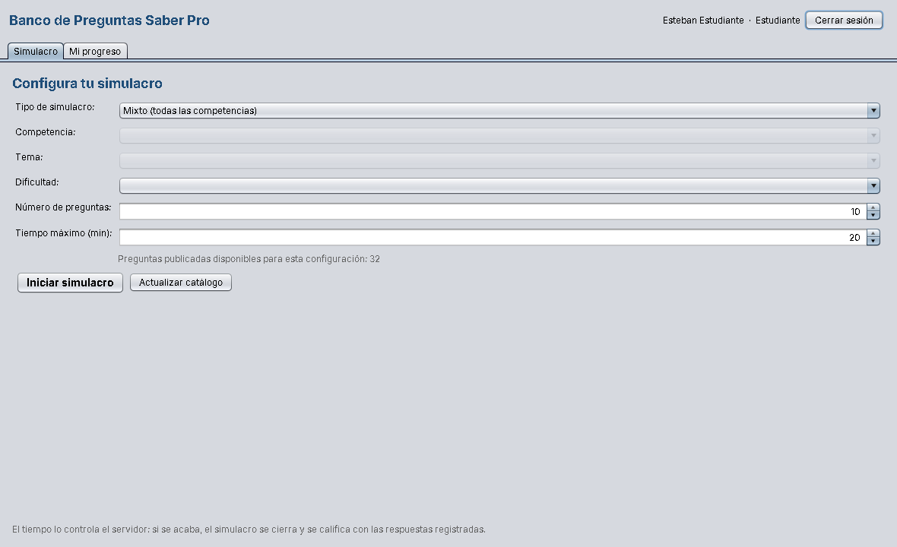
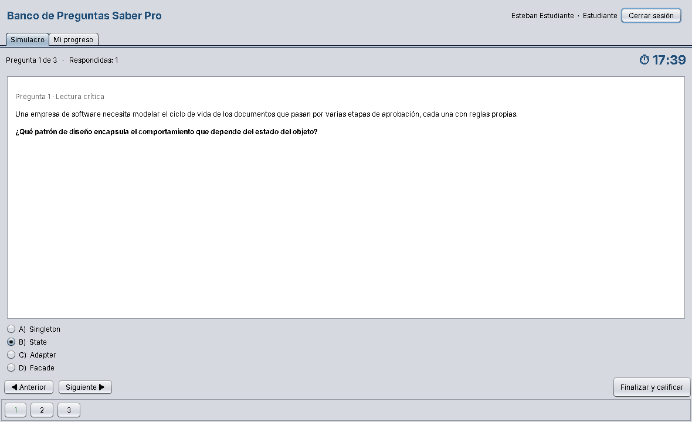
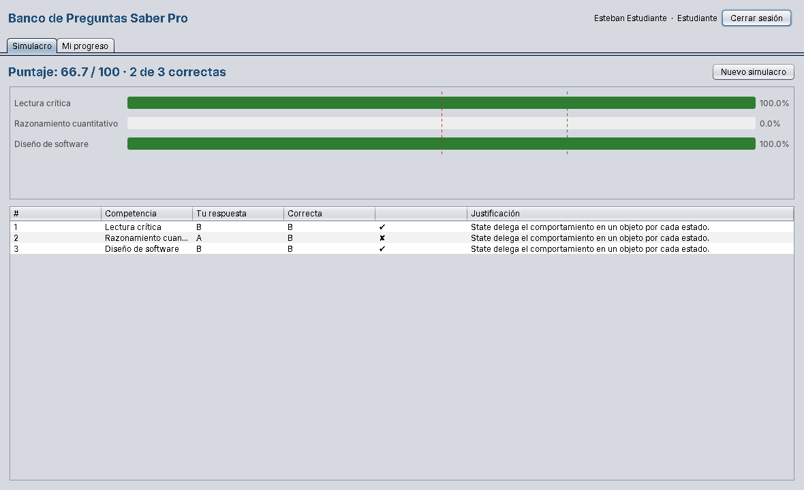
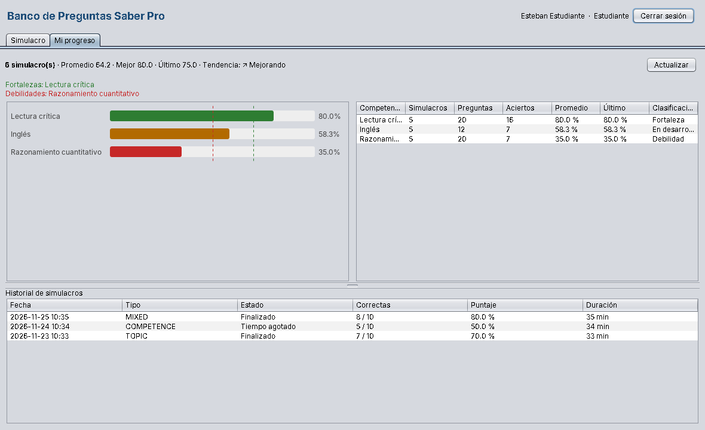
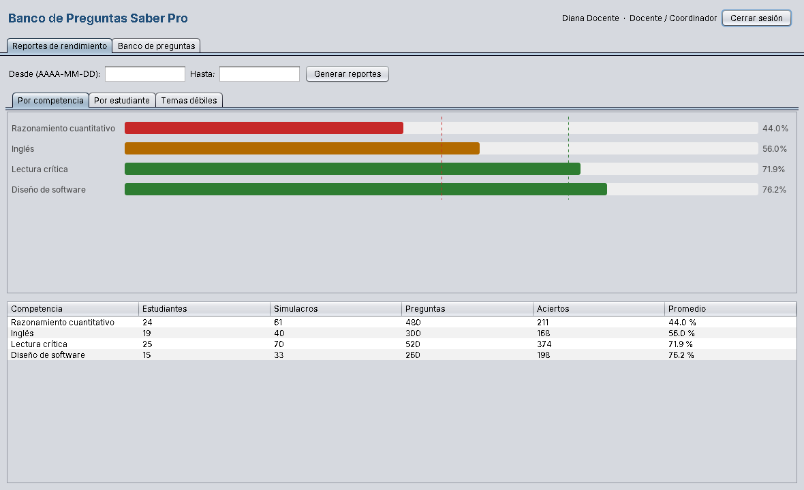
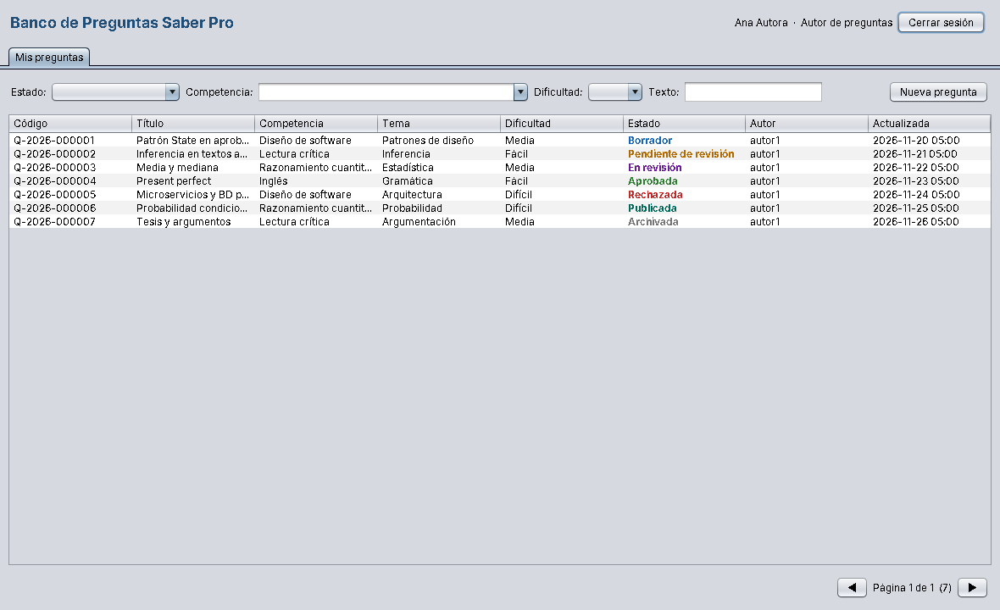
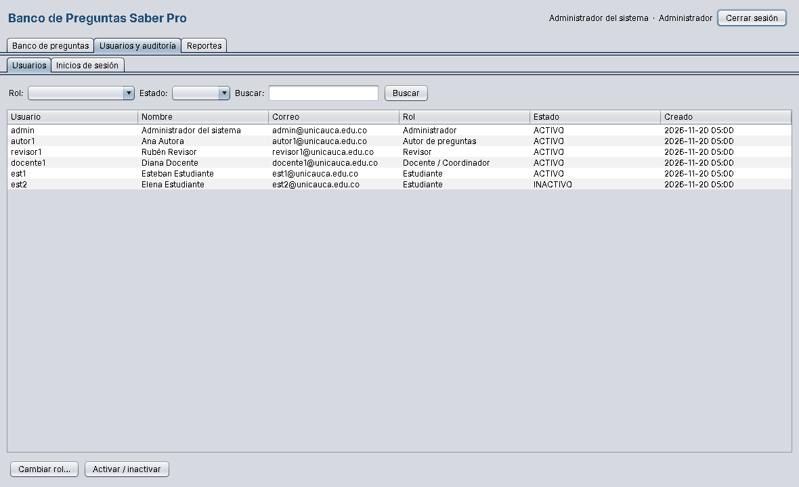

# B02 — Wireframes y protocolo de prueba de usabilidad (*Thinking Aloud*)

> **Corte 2 · Sprint B · Documentación previa** · Responsable: Integrante 3 · Talla M
> Los wireframes corresponden a las vistas implementadas en `swing-client` (B14, B15, B16).

## 1. Wireframes

### W1 — Configurar simulacro (Estudiante, B14)

```
┌────────────────────────────────────────────────────────────────────────────┐
│ Banco de Preguntas Saber Pro             Juliana Díaz · Estudiante [Salir] │
├─[ Simulacro ]─[ Mi progreso ]──────────────────────────────────────────────┤
│  Configura tu simulacro                                                    │
│                                                                            │
│  Tipo de simulacro:     [ Mixto (todas las competencias)         ▼]        │
│  Competencia:           [                                        ▼] (gris) │
│  Tema:                  [                                        ▼] (gris) │
│  Dificultad:            [                                        ▼]        │
│  Número de preguntas:   [ 10 ▲▼]                                           │
│  Tiempo máximo (min):   [ 20 ▲▼]                                           │
│                         Preguntas publicadas disponibles: 32               │
│                                                                            │
│  [ Iniciar simulacro ]  [ Actualizar catálogo ]                            │
│                                                                            │
│  El tiempo lo controla el servidor: si se acaba, el simulacro se cierra.   │
└────────────────────────────────────────────────────────────────────────────┘
```

### W2 — Presentar simulacro con cronómetro (B14)

```
┌────────────────────────────────────────────────────────────────────────────┐
│ Pregunta 3 de 10 · Respondidas: 2                              ⏱ 17:42     │
├────────────────────────────────────────────────────────────────────────────┤
│ Pregunta 3 · Lectura crítica                                               │
│ <Contexto de la pregunta …>                                                │
│ ¿Pregunta directa?                                                          │
│                                                                            │
│  ( ) A) Opción A                                                           │
│  (•) B) Opción B                                                           │
│  ( ) C) Opción C                                                           │
│  ( ) D) Opción D                                                           │
├────────────────────────────────────────────────────────────────────────────┤
│ [◀ Anterior] [Siguiente ▶]                         [Finalizar y calificar] │
│ [1✔][2✔][3][4][5][6][7][8][9][10]   ← navegador (verde = respondida)        │
└────────────────────────────────────────────────────────────────────────────┘
  Cronómetro: azul > 5 min · ámbar ≤ 5 min · rojo ≤ 1 min. Cada respuesta se
  guarda al instante en el servidor; al llegar a 00:00 se califica sola.
```

### W3 — Resultado inmediato (B14)

```
┌────────────────────────────────────────────────────────────────────────────┐
│ Puntaje: 70.0 / 100 · 7 de 10 correctas                 [Nuevo simulacro]  │
├────────────────────────────────────────────────────────────────────────────┤
│ Lectura crítica        ████████████████████░░░░░  80.0%   ┆50%  ┆70%       │
│ Razonamiento cuant.    ███████████░░░░░░░░░░░░░░  50.0%                    │
├────┬──────────────┬──────────────┬──────────┬───┬──────────────────────────┤
│ #  │ Competencia  │ Tu respuesta │ Correcta │   │ Justificación            │
│ 1  │ Lectura      │ B            │ B        │ ✔ │ …                        │
│ 2  │ Razonamiento │ —            │ C        │ ✘ │ …                        │
└────┴──────────────┴──────────────┴──────────┴───┴──────────────────────────┘
```

### W4 — Mi progreso (B15)

```
┌────────────────────────────────────────────────────────────────────────────┐
│ 6 simulacro(s) · Promedio 64.2 · Mejor 80.0 · Último 75.0 · ↗ Mejorando [Actualizar] │
│ Fortalezas: Lectura crítica                                    (verde)     │
│ Debilidades: Razonamiento cuantitativo                         (rojo)      │
│ ┌ gráfica de barras por competencia con líneas de 50 % y 70 % ┐           │
│ └─────────────────────────────────────────────────────────────┘           │
│ Competencia | Simulacros | Preguntas | Aciertos | Promedio | Último | Clase │
├────────────────────────────────────────────────────────────────────────────┤
│ Historial de simulacros                                                    │
│ Fecha | Tipo | Estado | Correctas | Puntaje | Duración                     │
└────────────────────────────────────────────────────────────────────────────┘
```

### W5 — Reportes del Docente / Coordinador (B16)

```
┌────────────────────────────────────────────────────────────────────────────┐
│ Desde (AAAA-MM-DD): [2026-11-01]  Hasta: [2026-11-30]  [Generar reportes]  │
├─[ Por competencia ]─[ Por estudiante ]─[ Temas débiles ]───────────────────┤
│ ┌ gráfica de promedio por competencia ┐                                    │
│ Competencia | Estudiantes | Simulacros | Preguntas | Aciertos | Promedio   │
│                                                                            │
│ (Por estudiante) tabla + [Ver fortalezas y debilidades del estudiante]     │
│ (Temas débiles)  Competencia | Tema | Respuestas | Aciertos | Tasa ↑       │
└────────────────────────────────────────────────────────────────────────────┘
```

### W6 — Banco de preguntas (Autor / Revisor / Administrador, A20)

```
┌────────────────────────────────────────────────────────────────────────────┐
│ Estado:[      ▼] Competencia:[      ▼] Dificultad:[  ▼] Texto:[     ] [Buscar] [Nueva pregunta] │
├──────────┬──────────────┬─────────────┬────────┬──────────┬─────────────────┤
│ Código   │ Título       │ Competencia │ Tema   │ Dificul. │ Estado (color)  │
├──────────┴──────────────┴─────────────┴────────┴──────────┴─────────────────┤
│ [Ver / editar] [Enviar a revisión] [Archivar]      ◀ Página 1 de 3 (42) ▶  │
└────────────────────────────────────────────────────────────────────────────┘
  Los botones de acción salen de allowedActions (patrón State en el servidor).
```

### Capturas del cliente implementado

Generadas con el cliente real contra un gateway simulado (datos de ejemplo), en [`capturas/`](capturas/):

| Wireframe | Captura |
|---|---|
| W1 Configurar simulacro |  |
| W2 Simulacro con cronómetro |  |
| W3 Resultado inmediato |  |
| W4 Mi progreso |  |
| W5 Reportes del docente |  |
| W6 Banco de preguntas (Autor) |  |
| Administración de usuarios |  |

## 2. Protocolo de prueba de usabilidad — *Thinking Aloud*

### 2.1 Objetivo
Detectar problemas de comprensión y eficiencia en las vistas nuevas (W1–W5) antes de la entrega, pidiendo a usuarios reales que **verbalicen lo que piensan** mientras usan el sistema.

### 2.2 Participantes
| Perfil | Cantidad | Criterio |
|---|---|---|
| Estudiantes de Ingeniería de Sistemas (6.º a 10.º semestre) | 4 | No participaron en el desarrollo |
| Docente / coordinador del programa | 1 | Usuario objetivo de W5 |

Cinco participantes detectan la mayoría de problemas de usabilidad graves (Nielsen).

### 2.3 Preparación
- Sistema levantado con `docker compose up` y `scripts/seed-preguntas.sh 8` (32 preguntas).
- Cuentas: `estudiante-ta1..4`, `docente1`. Cada estudiante con 0 simulacros previos.
- Grabación de pantalla y audio (OBS) con consentimiento informado firmado.
- Roles del equipo: **facilitador** (lee las tareas y solo recuerda "siga pensando en voz alta"), **observador 1** (anota citas y errores), **observador 2** (cronometra).

### 2.4 Guion
1. Bienvenida (2 min): "Evaluamos el sistema, no a usted. Diga en voz alta lo que piensa, lo que busca y lo que espera que pase."
2. Práctica de thinking aloud con una tarea neutra (1 min).
3. Tareas (sin ayuda; si se bloquea más de 2 min se registra como fallo y se continúa).
4. Cuestionario SUS (10 preguntas) y entrevista corta (5 min): ¿qué fue lo más confuso? ¿qué cambiaría?

### 2.5 Tareas

| # | Tarea (lo que se lee al participante) | Vista | Éxito | Tiempo objetivo |
|---|---|---|---|---|
| T1 | "Ingrese con su usuario y configure un simulacro de 5 preguntas de Lectura crítica con 10 minutos." | W1 | Simulacro iniciado con esos parámetros | ≤ 90 s |
| T2 | "Responda las preguntas. Cambie la respuesta de la pregunta 2. Vaya a la pregunta 5 sin pasar por las demás." | W2 | Respuesta cambiada y navegación directa | ≤ 4 min |
| T3 | "¿Cuánto tiempo le queda? ¿Cuántas preguntas le faltan?" | W2 | Responde correctamente leyendo la interfaz | ≤ 15 s |
| T4 | "Finalice y diga cuál pregunta falló y por qué era incorrecta." | W3 | Identifica la fila ✘ y lee la justificación | ≤ 60 s |
| T5 | "Diga cuál es su competencia más débil y cómo ha evolucionado." | W4 | Menciona la debilidad y la tendencia | ≤ 45 s |
| T6 (docente) | "Encuentre el tema con peor desempeño del grupo en noviembre." | W5 | Filtra fechas y abre "Temas débiles" | ≤ 90 s |
| T7 (docente) | "Vea las fortalezas del estudiante con mejor promedio." | W5 | Usa "Ver fortalezas y debilidades" | ≤ 60 s |

### 2.6 Métricas
| Métrica | Cómo se mide | Meta |
|---|---|---|
| Tasa de éxito por tarea | Completada sin ayuda | ≥ 80 % |
| Tiempo por tarea | Cronómetro del observador 2 | Dentro del objetivo |
| Errores | Clics en elementos equivocados, rutas fallidas | ≤ 2 por tarea |
| Satisfacción | Puntaje SUS | ≥ 68 |
| Problemas | Lista con severidad 0–4 (Nielsen) | Severidad ≥ 3 corregida antes de entregar |

### 2.7 Formato de registro (por participante)

| Tarea | ¿Éxito? | Tiempo | Errores | Cita textual relevante | Problema detectado | Severidad (0–4) |
|---|---|---|---|---|---|---|
| T1 | | | | | | |

### 2.8 Hipótesis a validar
- H1: el aviso de preguntas disponibles evita configuraciones imposibles (T1).
- H2: el color del cronómetro comunica la urgencia sin necesidad de leer los números (T3).
- H3: el navegador numerado con verde basta para saber qué falta responder (T2, T3).
- H4: la clasificación Fortaleza/Debilidad con colores se entiende sin explicar los umbrales (T5).

### 2.9 Resultados
Se diligencian tras la sesión en la sección "Wireframes y Thinking Aloud" del PDF (B20): tabla consolidada, problemas priorizados y cambios aplicados.
